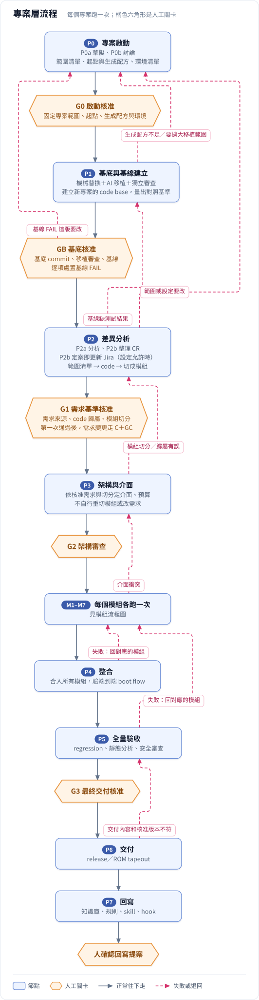
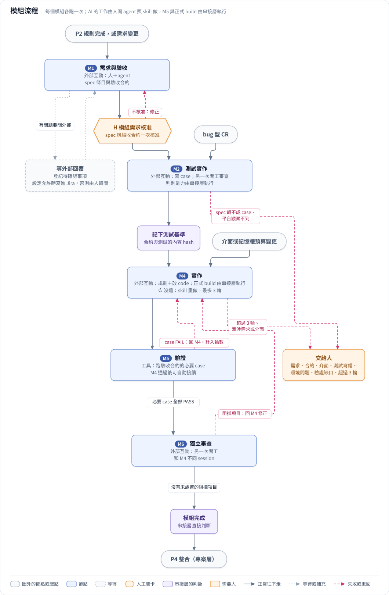

# 02 流程

> **這份文件回答**：流程怎麼走、有哪些節點、誰做、哪裡要人核准、遇到例外時交給誰、模組之間怎麼排。
>
> 每個節點的介面細節見 [nodes/](../nodes/README.md)；串接層怎麼開工、派工與收件見 [04 串接層規則](04_rules.md)。

---

## 2.1 專案層流程

圖源：[`diagrams/src/01_project_flow.mjs`](../diagrams/src/01_project_flow.mjs)

- **主流程**（實線，由上往下）：P0 → G0 → P1 →（基線有 FAIL 才經 GB）→ P2 → G1 → 各模組跑 M1 → H → M2 → M4 → M5 → M6 → P4 → P5 → G3 → P6 → P7。
- **退回**（紅色虛線）：P1 發現生成配方不完整或移植需要擴大範圍，回 P0；GB 決定某個基線 FAIL 這版要改，回 P0 改範圍清單；P2 發現範圍清單或專案設定要改，回 P0；模組遇到介面衝突回 P2；P4、P5 失敗回對應的模組；P6 交付內容和核准版本不符回 P5。
- **圖上沒畫的**：關卡不核准時退回關卡前的那一站；超過重做上限或遇到環境問題時交給人；變更 CR 與新 commit 的處理見 §2.5。

**P1 建立基底**：新 IC 或要換 register 的專案，P1 依 G0 核准的生成配方建立這個專案的 code base——先由確定性工具做機械替換，再由 AI 在限定的移植範圍內補足，經獨立審查後量出基線（[nodes/P1](../nodes/P1.md)）。建立新專案的 code base 不是任何一張 CR 的內容，而 P2 之後的節點都要以新專案的 code 為準，所以放在 P1，不交給模組。

範圍在 P0 決定「做不做、留不留」；P2 把已核准的範圍對到 code、切成模組、定介面與預算，必要時整理 CR；M1 再決定每個模組的行為細節與驗收標準。三站不重複討論同一件事。

---

## 2.2 節點總表

| 節點 | 做什麼 | 主要產出物 | 由誰做 | 出口關卡 |
| :---- | :---- | :---- | :---- | :---- |
| [P0 專案啟動](../nodes/P0.md) | 定範圍（新增、修改、保留、移除、這版不做）、起點、生成配方、環境 | project.md、範圍清單、專案設定、環境清單 | 外部互動 | G0 |
| [P1 基底與基線建立](../nodes/P1.md) | 依生成配方建立新專案的 code base（機械替換＋AI 移植＋獨立審查），量出對照基準 | 基底 commit、基底建立紀錄、基線報告 | 派工 | GB（基線有 FAIL 時） |
| [P2 規劃](../nodes/P2.md) | 範圍清單 → code → 切成模組；定模組介面與記憶體預算；必要時整理 CR | 差異分析、架構文件、CR 修訂紀錄（有修訂時） | 外部互動 | G1 |
| [P4 整合](../nodes/P4.md) | 合入所有模組，驗端到端 boot flow | 整合 branch、boot flow 報告 | 派工 | — |
| [P5 全量驗收](../nodes/P5.md) | 證明其他功能沒被改壞 | 全量驗收報告 | 派工 | G3 |
| [P6 交付](../nodes/P6.md) | 交出最終版本 | release 包 | 人 | — |
| [P7 回寫](../nodes/P7.md) | 把這次的錯變成下次的能力 | 回寫提案 | 外部互動 | — |
| [C 變更](../nodes/C.md) | 決定變更 CR 接不接、接了從哪裡重做 | 變更決定 | 外部互動 | GC |
| [M1 需求與驗收](../nodes/M1.md) | 把需求寫成有編號的 spec 條目，並定「什麼叫做完」 | 模組 spec、驗收合約 | 外部互動 | H |
| [M2 測試實作](../nodes/M2.md) | 寫 case，證明 case 抓得到錯 | 測試實作、判別能力證據 | 派工 | — |
| [M4 實作](../nodes/M4.md) | 規劃並改 code、build | 模組 commit | 派工 | — |
| [M5 驗證](../nodes/M5.md) | 證明 image 符合驗收合約 | 驗證報告 | 派工 | — |
| [M6 獨立審查](../nodes/M6.md) | 由另一個執行者審查 diff | 審查報告 | 派工 | — |

**外部互動**：由人自己開 agent 完成，串接層只開工與收件（[04 §4.2](04_rules.md#42-兩種執行方式)）。**派工**：由串接層派工給 AI 或工具，人不參與。

v0.9 起不再使用 P3（併入 P2）、M3（併入 M4）、M7（模組完成由串接層直接判斷）。

---

## 2.3 模組流程

圖源：[`diagrams/src/02_module_flow.mjs`](../diagrams/src/02_module_flow.mjs)

- **主流程**：M1 → H → M2 → M4 → M5 → M6 → 模組完成 → P4 整合。
- **模組完成**：M5 必要 case 全部 PASS、M6 沒有未處置的阻擋項目、H 核准對應目前的 spec 與合約。由串接層直接判斷，不另設節點。
- **M1 有問題要問外部**時，節點轉為「等外部回覆」，答案回來再從 M1 接續。
- **節點內重做**：M4 build 不過、有 warning、超出預算或 M5 測試沒過，回 M4 重做，最多 3 輪；其他問題交給人決定回哪一站（[04 §4.5](04_rules.md#45-失敗處理)）。

**模組流程從哪裡進來**：

| 從哪裡來 | 進入點 |
| :---- | :---- |
| P2 規劃（第一次） | M1 |
| C 變更：需求變更（spec 要改） | M1 |
| C 變更：bug 型 CR（spec 本來就對，是 code 錯） | M2：先補一個能重現 bug 的 case |
| P2 改版（介面或記憶體預算變了） | M4 |
| 人指定的退回 | 人決定的那一站 |

---

## 2.4 人工關卡

| 關卡 | 位置 | 核准什麼 | 什麼時候要重開 |
| :---- | :---- | :---- | :---- |
| G0 啟動核准 | P0 的出口 | 範圍、起點、生成配方、環境 | project.md、範圍清單、專案設定，或影響 build 的環境項目改版 |
| GB 基線處置 | P1 的出口，**只在保留的既有功能於基底上 FAIL 時** | 逐項決定每個 FAIL：移植問題、這版要改，或接受並記錄理由 | 基線重量後又有 FAIL |
| G1 規劃核准 | P2 的出口 | 範圍對到 code 的結果、模組切分、regression 範圍、介面與記憶體預算、CR 修訂（有的話） | 模組切分、介面或預算改變 |
| H 模組需求核准 | M1 的出口，每個模組一次 | 模組 spec 條目與驗收合約 | spec 條目或驗收合約改變；在合約內補 case 不重開 |
| G3 最終交付核准 | P5 之後、P6 之前 | 全量驗收結果，綁定整合 branch 的 commit 與 image hash | image 或驗收結果改變 |
| GC 變更核准 | C 的出口 | 這張變更 CR 這一版接或不接；接的話從哪裡重做 | 每張變更 CR 各一次 |

基底 build 零警告、基線量完、保留的既有功能沒有 FAIL 時，P1 直接完成，不需要 GB。P7 的回寫提案由人有空時處理，不是關卡，也不擋交付。

所有關卡共同的規則：

- **關卡只做決定，討論在前一站**：需要討論的關卡，前一站就是人在場的外部互動節點（P0 → G0、P2 → G1、M1 → H、C → GC）；GB、G3 只需要審閱。
- **核准人**：每個關卡由專案設定列的核准人核准（[07](07_project_profile.md)）。
- **最後一步必須由人親自完成**：送出決定的那個動作，必須是 AI 無法代為完成的；AI 可以協助審閱，但不能替人核准，也不能把一句「ok」當成核准。
- **AI 不給核准建議**：AI 協助審閱時，只把檢查結果、還沒解決的項目擺出來，讓核准人對關鍵風險逐項表態，不說「建議核准」。
- **核准綁定 commit**：核准紀錄記下核准的人、時間、關卡與核准時的 commit（[03 §3.6](03_artifacts.md#36-紀錄)）。核准之後內容又改了，這筆核准就不算數。
- **不核准**：退回關卡前的那一站修正。
- **核准在動作之前**：G3 放在 P6 交付之前，因為 mask ROM 交付後不能回頭。

實作方式（簽核 skill、確認動作）見 [impl/gate_signoff](../impl/gate_signoff.md)。

---

## 2.5 例外情況交給誰

| 情況 | 由誰處理 | 結果 | 規則 |
| :---- | :---- | :---- | :---- |
| 派工節點的擋關檢查沒過 | 節點內重做，最多 3 輪 | 超過就交給人 | [04 §4.5](04_rules.md#45-失敗處理) |
| 其他失敗（需求不清、介面衝突、測試寫錯、環境問題） | 交給人 | 人決定回哪一站、修好環境重跑，或這版不做 | [04 §4.5](04_rules.md#45-失敗處理) |
| G1 核准前，CR／spec 新增或修改 | P0／P2 的討論 | 範圍要改的回 P0、其他在 P2 處理 | [04 §4.6](04_rules.md#46-需求變更) |
| G1 核准後，CR／spec 新增、修改或取消 | C＋GC | 不接就記錄；接就從人指定的那一站重做 | [04 §4.6](04_rules.md#46-需求變更) |
| 上游檔案改版、有人直接 commit | 影響提示 | 串接層列出受影響的節點，人決定重做哪裡 | [04 §4.4](04_rules.md#44-上游改版與重做)、[§4.7](04_rules.md#47-新-commit-與人工修改) |

---

## 2.6 模組之間

- **哪些模組要排隊、哪些可以平行**：
  - **改到的檔案有重疊**的模組要排隊：一個做完，下一個才開始。衝突熱點檔案（專案設定列的）是一定會重疊的例子，例如 E39 會改 `lcp.c` 的幾個模組。
  - **要用到另一個模組實作結果**（不只是 P2 定好的介面）的模組要排隊：被依賴的模組完成，依賴它的才開始。
  - **其他模組可以平行**：只依賴 P2 定好的介面，改的檔案也沒有重疊。實際同時跑幾個，由串接層看資源決定（例如驗證設備的數量、核准人有沒有空）。
  - **做到一半才發現撞檔案**：交給人決定排隊順序。
- **每個模組各跑一次模組流程**（模組是 P2 切出的一組 CR，不是一張 CR 一個模組）。所有模組完成後才進入 P4；P4、P5 失敗時，回到對應的模組。
- **模組已經合入整合 branch 後又被重新打開**時，P4、P5 要重跑。
