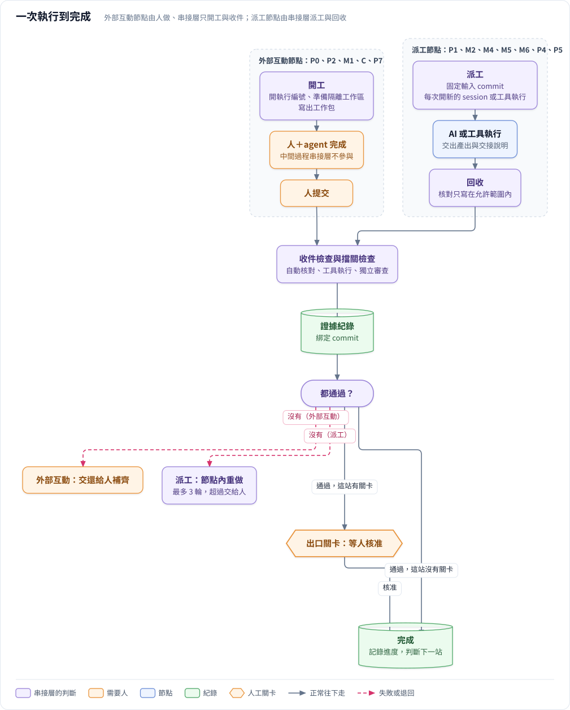
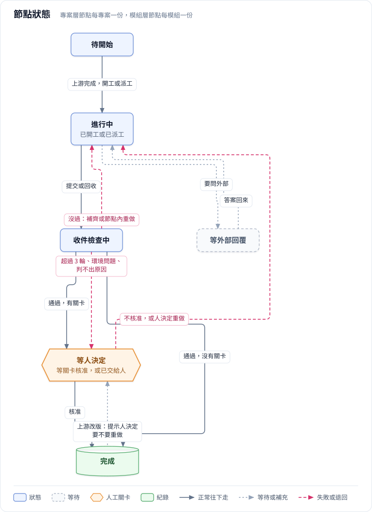
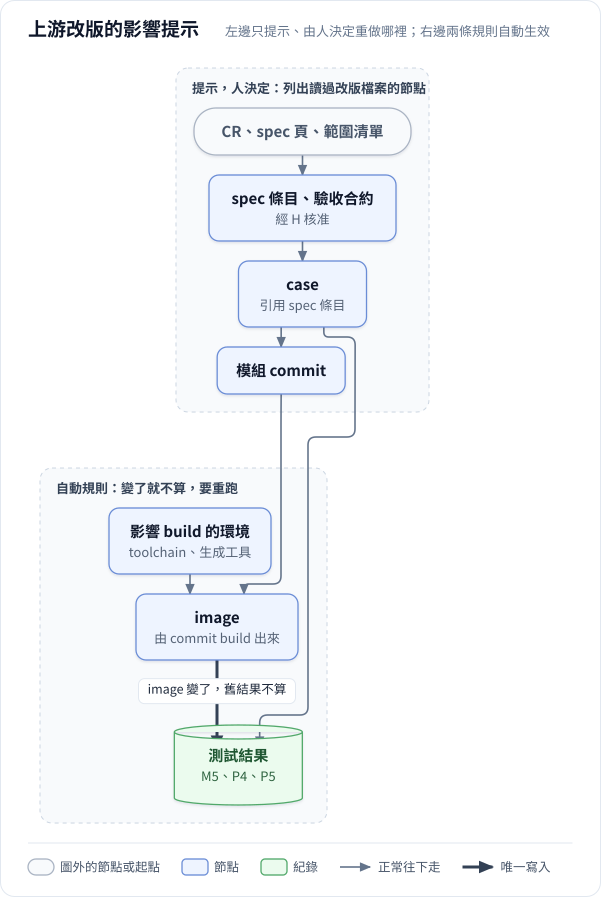
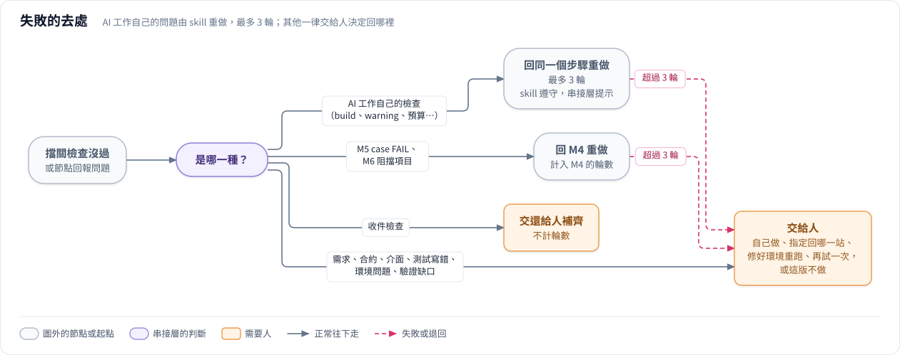
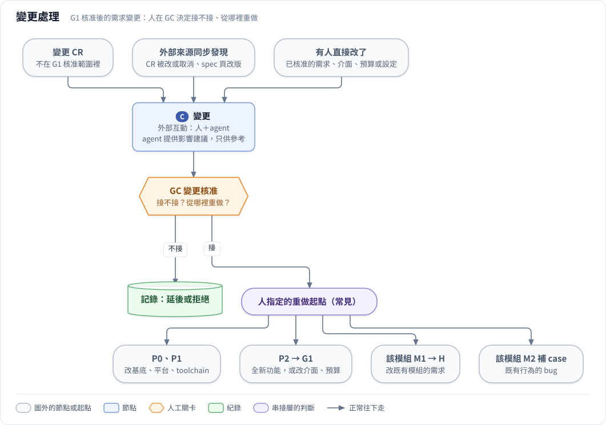
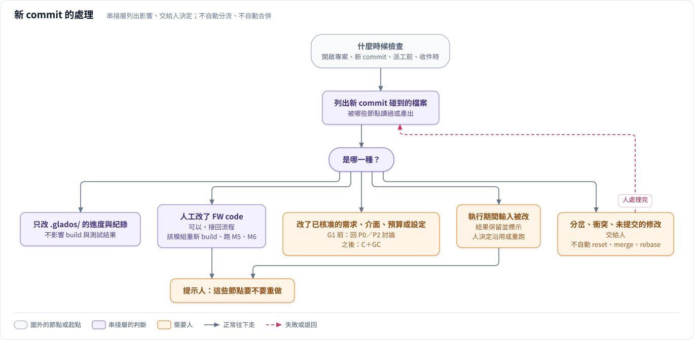

# 04 串接層規則

> **這份文件回答**：串接層怎麼開工、派工與收件，失敗、上游改版、需求變更、新 commit 時怎麼處理。
>
> 串接層「要做到哪些事」（背景常駐、持久保存…）見 [06 串接層服務的要求](06_service.md)；用什麼程式實作見 [impl/service.md](../impl/service.md)。建置路線步驟 2 由人扮演串接層時，照同一份規則執行。

---

## 4.1 串接層是什麼

串接層是確定性的流程管理者，**不是 LLM**。它做四件事：

- **開工與派工**：為外部互動節點準備工作區與工作包；把派工節點交給 AI 或工具執行。
- **收件與擋關**：執行收件檢查與擋關檢查，留下證據；不相信節點自己寫的「通過」。
- **記錄**：記下執行、證據、核准與進度。
- **提示**：上游改版、有新 commit、外部來源有差異時，列出可能受影響的節點，交給人決定。

LLM 可以提供影響建議或失敗判讀，但只是給人參考，不能自己決定放行。

---

## 4.2 兩種執行方式

圖源：[`diagrams/src/03_dispatch_release.mjs`](../diagrams/src/03_dispatch_release.mjs)

### 外部互動節點（P0、P2、M1、C、P7）

需要人參與的節點，**中間過程由人自己開 agent 完成，串接層不派工、不參與**。

1. **開工**：串接層開一個執行編號，準備只含允許內容的工作區與固定輸入，產生工作包（[03 §3.5](03_artifacts.md#35-工作包)）。
2. **進行中**：人和 agent 照工作包完成產出與交接說明。怎麼做由人決定，不受迴圈上限限制。
3. **提交**：人送出提交，串接層以當下的 commit 為準，執行收件檢查與這個節點的擋關檢查。
4. **沒過**：把缺什麼交還給人，回到「進行中」。
5. **過了**：有出口關卡就等核准人送出決定；沒有就完成。

### 派工節點（P1、M2、M4、M5、M6、P4、P5）

不需要人的節點，由串接層派工：

1. **派工前**：固定這次的輸入 commit；上游必須已完成；這個節點目前沒有其他執行中的嘗試；需要的環境可用。
2. **派工**：每次開新的 session 或工具執行，只給節點卡、上游產出物與交接說明，不給前一站的對話。
3. **回收**：收產出、交接說明與 log；確認只寫在允許範圍內。
4. **擋關**：執行這個節點的擋關檢查，每項留證據紀錄（[05](05_checks.md)）。
5. **沒過**：在節點內重做，最多 3 輪；超過交給人（§4.5）。
6. **過了**：有出口關卡就等核准；沒有就完成，再判斷下一站能不能開始。

**程式正常結束（exit 0）只代表程式跑完了，不代表節點完成。** 執行期間輸入被改了，結果保留但標示出來，由人決定要不要重跑（§4.7）。

---

## 4.3 節點狀態

專案層節點每個專案一份；模組層節點每個模組一份。執行本身的細部狀態（準備中、核對中、待同步等）是串接層服務的實作細節，見 [impl/service.md](../impl/service.md)。

圖源：[`diagrams/src/04_node_state.mjs`](../diagrams/src/04_node_state.mjs)

| 狀態 | 意思 |
| :---- | :---- |
| 待開始 | 上游還沒完成 |
| 進行中 | 已開工或已派工 |
| 收件檢查中 | 已提交或已回收，串接層正在檢查 |
| 等人決定 | 等出口關卡核准，或已交給人 |
| 等外部回覆 | 有待確認事項要等客戶、SOC、HW 回答 |
| 完成 | 擋關檢查都過，必要核准齊全 |

完成的節點，上游又改版時不會自動變回待開始；串接層提示「這個節點讀過的檔案改了」，由人決定要不要重做（§4.4）。重做是新的一次執行，舊的執行與決定都保留。

「等外部回覆」由人標記（列出待確認事項）與解除（寫下回覆），記在執行紀錄（[03 §3.6](03_artifacts.md#36-紀錄) 的 `wait`、`resume`）；等待中不能提交。

---

## 4.4 上游改版與重做

**原則**：

- **要改的產出物，由產出它的那一站重做**。例如 spec 有缺口，由 M1 重寫 spec，不由發現問題的那一站代改。
- **上游改了，串接層提示，人決定**：串接層從執行紀錄知道每個節點讀過哪些檔案；某個檔案改了，就列出讀過它的節點，由人決定從哪一站重做。

圖源：[`diagrams/src/05_trace.mjs`](../diagrams/src/05_trace.mjs)

**只有兩條自動規則**，因為它們客觀、便宜，而且錯了會直接影響交付：

| 什麼改變 | 自動怎麼處理 |
| :---- | :---- |
| image 改變 | 用舊 image 跑出來的 M5、P4、P5 測試結果不算，要用新 image 重跑。spec、合約、case 的定義不受影響 |
| 影響 build 的環境項目改變（toolchain、生成工具） | 照「改基底、平台或 toolchain」處理：重新 build，之前的 build 與測試結果不算；生成工具或程式碼建立設定改變時重新建立基底 |

skill、MCP、知識庫只影響 AI，更新後不讓任何結果失效；之後的執行用新版本，執行紀錄記下用了哪一版。

**重做時附上原因**：人指定某一站重做時，原因（例如「B2 改了」「M5 的 case-12 FAIL」）寫在決定紀錄的 `note`，串接層開工或派工時一併交給那一站。對影響提示的決定（重做或不用重做）都要寫原因，由專案設定「交給人時通知誰」名單上的人做（[07 §7.1](07_project_profile.md#71-欄位)）。

---

## 4.5 失敗處理

圖源：[`diagrams/src/06_failure_routing.mjs`](../diagrams/src/06_failure_routing.mjs)

| 情況 | 怎麼處理 |
| :---- | :---- |
| 派工節點自己的擋關檢查沒過（例如 M4 build 不過、有 warning、超出預算） | 在節點內重做，最多 3 輪 |
| M5 必要 case FAIL | 回 M4 重做，計入 M4 的輪數 |
| M6 審查有阻擋項目 | 回 M4 修正，計入 M4 的輪數；修正後重跑 M5、M6 |
| 超過 3 輪 | 交給人 |
| 需求不清或矛盾、驗收標準要改、介面衝突、測試寫錯、需要改計畫以外的大範圍、環境問題、驗證缺口 | 交給人，附上失敗摘要與證據 |
| 外部互動節點的檢查沒過 | 交還給人補齊，不計輪數 |

交給人時，串接層附上：哪個節點、跑了幾輪、每一輪的失敗證據、目前擋住的原因。人的決定記成決定紀錄（[03 §3.6](03_artifacts.md#36-紀錄)）：

| 人的決定 | 之後怎麼走 |
| :---- | :---- |
| 自己來做這一站 | 人是合法的執行者，交出產出，照同樣的擋關檢查 |
| 指定回哪一站（例如判定是測試錯 → M2，spec 缺口 → M1） | 串接層照這個決定開工或派工，附上決定紀錄當原因 |
| 修好環境後重跑 | 回到同一站；不算一輪 |
| 再試一次 | 回到同一站，輪數從頭算；可附補充說明 |
| 這一版不做這個模組或功能 | G1 核准前回 P0 改範圍清單、重開 G0；之後走 C＋GC |

**硬規則**：實作的 AI 不能自己改測試或驗收合約，也不能自己把失敗判成「測試錯」然後放行。這由擋關檢查「測試沒被動過」擋住；要改測試或合約，一定經人決定回 M1 或 M2。人的決定不能代替關卡核准：要改驗收合約，仍然要重新經 H。

---

## 4.6 需求變更

**一條規則**：G1 核准之前，CR 的新增、修改、取消都在 P0 或 P2 的討論裡處理；G1 核准之後，一律進 C，由人在 GC 決定接不接，接了就由人指定從哪一站重做。

圖源：[`diagrams/src/07_change_flow.mjs`](../diagrams/src/07_change_flow.mjs)

- **G1 核准前**：新 CR、取消 CR、會改範圍標記的，回 P0 改範圍清單、重開 G0；拆分、補描述、釐清 code 對應等，在 P2 處理。
- **G1 核准後**：不管 Jira／Confluence 上是什麼時候改的，只要不在 G1 核准時的範圍裡，都進 C。agent 可以提供影響建議（改到哪些產出物、建議從哪裡重做），但只是參考。
- **接受之後**：工具產生來源快照的新版本；範圍清單要改時由 C 一起改，GC 核准就算數，不另外重開 G0。其他要改的產出物由人指定的那一站重做，照那一站的檢查與關卡。

常見的重做起點（只是參考，由人在 GC 決定）：

| 變更類型 | 從哪裡重做 |
| :---- | :---- |
| 改基底、平台或 toolchain（包括程式碼建立設定或外部來源換版） | P0、P1，重新建立基底 |
| 全新功能，不碰既有模組 | P2 追加模組 → G1 → 新模組從 M1 開始 |
| 改模組介面或記憶體預算 | P2 → G1 → 受影響的模組從 M4 重做 |
| 改既有模組的需求 | 該模組 M1 → H |
| 既有行為的 bug（spec 本來就對） | 該模組 M2 補一個能重現 bug 的 case → M4 |
| 這一版不做 | 不重做，記錄理由 |

**變更進來的時間點**：模組還沒開始，直接併進該模組；模組正在跑，等目前節點做完再切換，不在節點做到一半時打斷；模組已合入整合 branch，重新打開該模組，P4、P5 要重跑。

**外部來源同步**：串接層定期（間隔寫在專案設定）重新查詢專案設定的 Jira Epic 與 spec 頁，和目前採用的快照比對，列出差異交給人：G1 核准前交給 P0／P2 的討論，之後交給 C。只有狀態改變、內容沒變的不算差異；查詢失敗記環境錯誤，不能當成「沒有差異」。

---

## 4.7 新 commit 與人工修改

**什麼時候檢查**：開啟或更新專案、偵測到追蹤中 branch 的新 commit、派工前、收件時。只是查詢時可以只讀。

圖源：[`diagrams/src/08_sync_flow.mjs`](../diagrams/src/08_sync_flow.mjs)

- **列出影響**：新 commit 碰到的檔案，被哪些節點讀過或產出，照 §4.4 提示人。
- **人工直接改 FW code 可以**：人工的修改接回流程，不要求 AI 重寫；該模組重新 build、跑 M5 與 M6，image 變了照 §4.4 的自動規則處理。
- **執行期間輸入被改了**：結果保留，但標示「輸入已改變」，由人決定沿用還是重跑。
- **只改 `.glados/` 的進度與紀錄**：不影響 FW 的 build 與測試結果。
- **branch 分岔、衝突、工作區有未提交的修改**：顯示具體原因，交給人；**不默默覆蓋、reset、merge 或 rebase 人的修改**。
- **人工改了已核准的需求、介面、預算或專案設定**：不算已核准；G1 核准前回 P0／P2 討論，之後走 C＋GC。

---

## 4.8 審查放行

P1 移植審查、M2 測試審查、M6 code 審查、P5 安全審查，都由和被審者不同的執行者（另一個 session，最好換模型）進行，不採「兩個 AI 達成共識」。每一項發現各記一筆（[03 §3.6](03_artifacts.md#36-紀錄)），依下表放行：

| 發現 | 放行規則 |
| :---- | :---- |
| 功能錯誤、安全問題、記憶體越界、介面違約，或違反專案設定的必要規則 | 沒解決就擋住；修正後重新審查，或由審查者依證據確認不成立 |
| 純風格或非必要的改善建議 | 記錄並說明處置，可以放行 |
| 牽涉需求、驗收標準或架構決策的爭議 | 交給人決定，不由模型投票改變已核准的決策 |

- 實作者不能自己把阻擋項目降級或關閉。
- 審查結果綁定被審的 commit；被審的內容改了，要重新審查。
- **必要規則清單由各專案定**，寫在專案設定（[07](07_project_profile.md)）；違反清單上的規則一律算阻擋項目。
